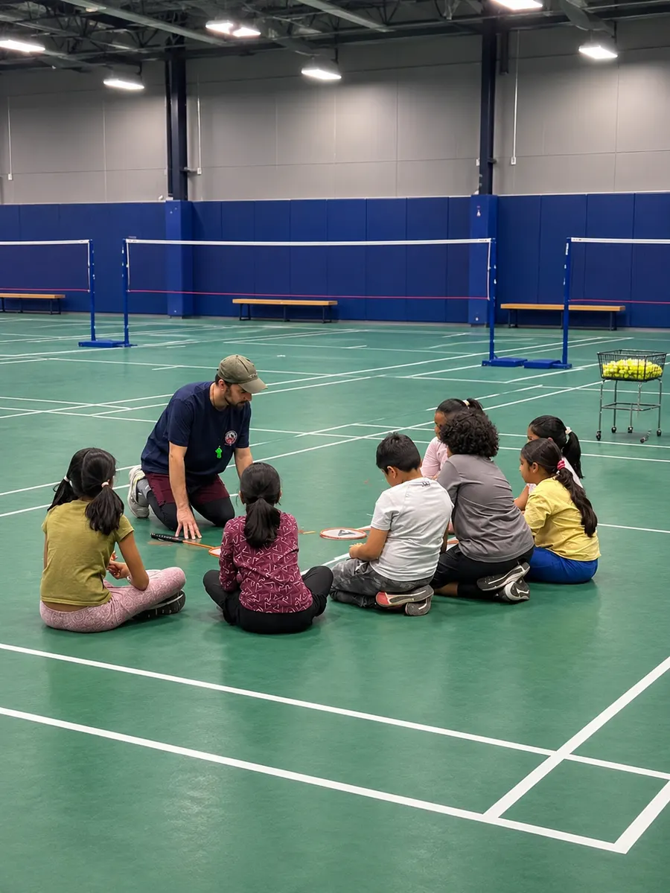
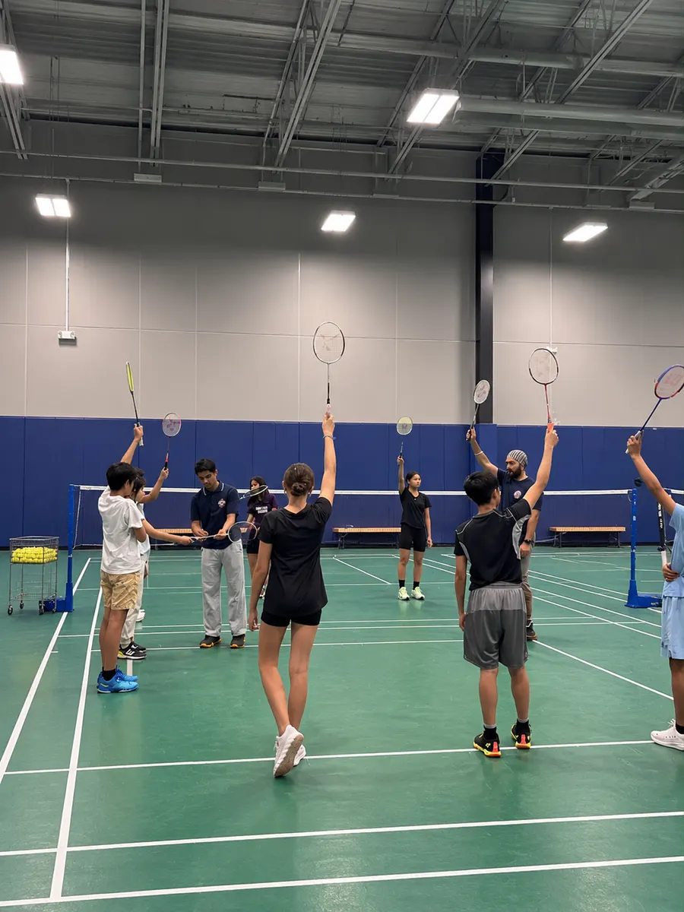

Registration for **National Smash Winter 2027** is now open on TeamLinkt. Whether your athlete is picking up a racket for the first time or is ready for intensive match training, there is a Smash tier built for them, and every one of them runs twice a week at the University of Regina Green Gym.

DatesJan 26 – Mar 112027, ten sessions

DaysTue &amp; ThuEvenings

VenueGreen GymU of R, 3737 Wascana Parkway

From$1503 installments available

<figure><figcaption>Coach-led skill circles</figcaption></figure>
<figure><figcaption>Warm-up and racket readiness</figcaption></figure>

## Choose the Right Smash Tier

Smash Juniors and Smash Elite are **open, mixed-level classes**, which means beginners and more experienced players train together and coaches adjust the drills for each athlete. Smash Pro is the intensive batch for players who want high-level tactical training and matchplay.

Ages 6–10Smash Juniors$150<small>CAD</small>Tue &amp; Thu · 10 sessions Batch 1: 6:00–6:45 PM Batch 2: 6:45–7:30 PM

Ages 11–16Smash Elite$175<small>CAD</small>Tue &amp; Thu · 10 sessions Batch 1: 6:00–6:45 PM Batch 2: 6:45–7:30 PM

Ages 10–16Smash Pro$295<small>CAD</small>Tue &amp; Thu · 10 sessions 6:00–7:30 PM · 90-minute sessions Intensive tactical training &amp; matchplay

### Smash Juniors (Ages 6–10)

The starting point for young players. Sessions build physical literacy, hand-eye coordination and neutral grip habits through games, then add underhand serving accuracy, court boundaries, gentle net drops and swat attacks. The block ends with a fun mini-meet where every player competes and earns recognition.

### Smash Elite (Ages 11–16)

For players ready for tactical footwork and shot variety. Elite covers forehand and backhand grip switching, split-step timing, low backhand flick serves, attacking and defensive clears, net spins, flat drives and jump smashes, and finishes with doubles rotations and tournament-style matchplay.

### Smash Pro (Ages 10–16)

The intensive option. Ninety-minute sessions focus on singles and doubles pattern building, serve and receive tactics, pressure situations and structured match days, built for players who want to compete.

## Session Dates

Smash Winter 2027 runs ten sessions on Tuesdays and Thursdays:

- **January:** 26, 28
- **February:** 2, 4, 23, 25
- **March:** 2, 4, 9, 11

There are **no sessions from February 9 to 18**.

## What It Costs

| Item | Cost |
| --- | --- |
| Smash Juniors tuition | $150 CAD |
| Smash Elite tuition | $175 CAD |
| Smash Pro tuition | $295 CAD |
| Mandatory Training Kit fee | $30 CAD per athlete |

Tuition can be split into **three installments**. The $30 Training Kit fee is paid in full and is not part of the installment plan. Any eligible sibling discount is applied automatically through the TeamLinkt system at checkout.

## What to Bring

<strong>Bring your own racket.</strong> NAA does not provide rackets. Yonex practice shuttles are provided for all drills.

Players also need clean, non-marking indoor court shoes, comfortable athletic clothing and a water bottle.

## How to Register

1. **Pick a tier and batch.** Smash Juniors and Elite choose between the 6:00 and 6:45 batches. Smash Pro runs 6:00–7:30 PM.
2. **Register on TeamLinkt.** Use the button below and complete the registration for your athlete.
3. **Get the TeamLinkt app.** Final schedules, batch assignments and court check-in updates are posted there, along with any cancellations.

Groups are kept small by coach-to-athlete ratios, so register early to secure the batch that works best for your family.

Smash Winter 2027 registration is open

Jan 26 – Mar 11 · Tuesdays &amp; Thursdays · U of R Green Gym

<a class="post-btn" href="https://app.teamlinkt.com/register/find/nationalathleticsacademy?cid=81569" target="_blank" rel="noopener noreferrer">Register for Smash Winter 2027 →</a>

## Coming Up Next: National Smash Open 2027

If your player loves match day, mark **February 27, 2027** for the [National Smash Open 2027](/programs/tournaments/badminton/national-smash-open-2027/), a one-day tournament on eight courts at the University of Regina. Registration for the tournament opens on **November 15, 2026**.

You can read the full program details any time on the [National Smash program page](/programs/badminton/). Questions? [Contact us](/contact/) and we will help you choose the right tier.
