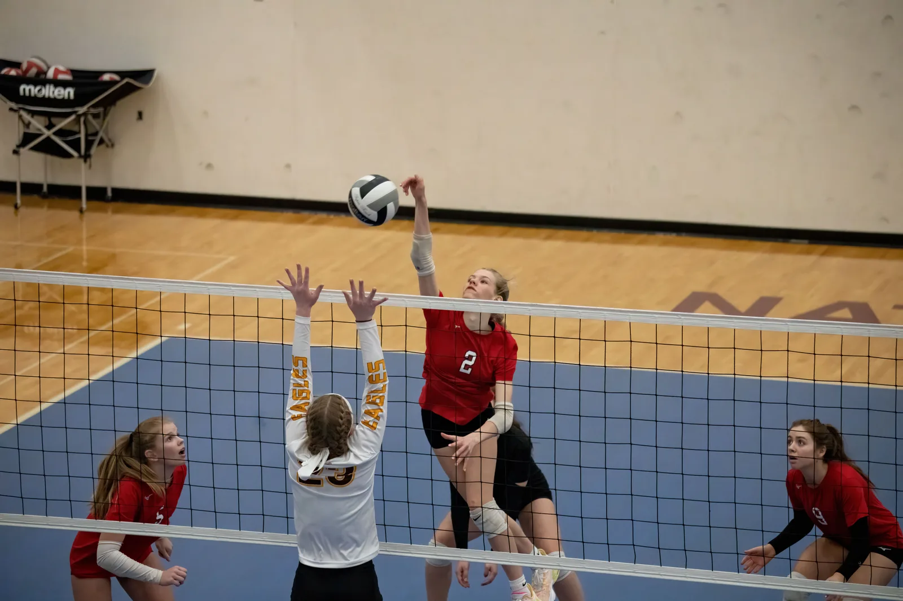
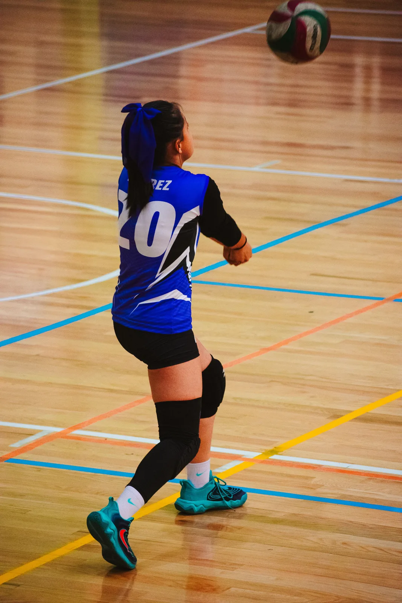
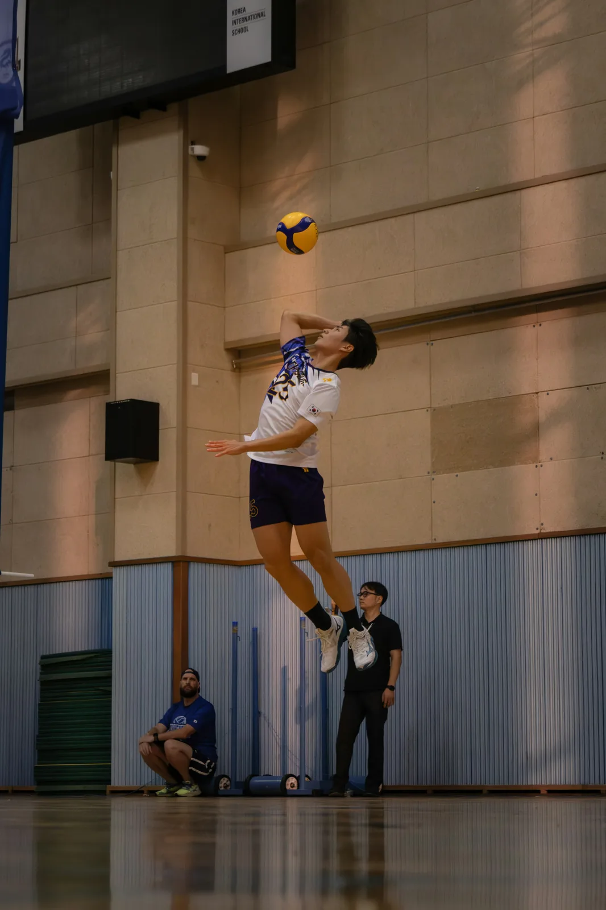

Registration for **National Spike Winter 2027** is now open on TeamLinkt. Two tiers, two evenings a week and ten sessions of structured coaching: Spike Juniors for ages 8 to 12, and Spike Elite for ages 13 to 16, all at the University of Regina Green Gym.

DatesJan 26 – Mar 112027, ten sessions

DaysTue &amp; ThuEvenings

VenueGreen GymU of R, 3737 Wascana Parkway

From$1953 installments available

<figure><figcaption>Technique first, then teamwork at the net</figcaption></figure>

## Two Tiers, One Clear Pathway

Each tier has its own group, its own time slot and a curriculum matched to age and experience.

Ages 8–12Spike Juniors$195<small>CAD</small>Tue &amp; Thu · 10 sessions 6:00–7:15 PM · 75-minute sessions Beginners welcome

Ages 13–16Spike Elite$245<small>CAD</small>Tue &amp; Thu · 10 sessions 6:00–7:30 PM · 90-minute sessions Float serves, spike approach &amp; 6v6 play

### Spike Juniors (Ages 8–12)

Built for players who are new to volleyball or still learning the fundamentals. Athletes work on moving to the ball, a solid forearm platform for passing, soft overhead setting touch, and underhand serving that grows into an overhand serve. Lightweight Mikasa trainer balls and age-adjusted net heights keep early learning comfortable, and modified small-sided games mean everyone touches the ball often.

### Spike Elite (Ages 13–16)

For players ready to compete. Elite sessions cover overhand float serving, spike approach timing and takeoff, block positioning, defensive digging, offensive transition and full 6v6 play, with an emphasis on communication and the three-contact rally of **pass, set, attack**.

## What Your Athlete Will Work On

- **Passing:** platform angle, shoulder shrug and target control
- **Setting:** finger placement, footwork and body alignment
- **Serving:** toss consistency and contact, from underhand to overhand
- **Attacking:** the three-step and four-step spike approach, arm swing and safe landings
- **Defense:** base position, tip coverage, digging and court communication
- **Game sense:** rotations, free-ball transitions and managing a rally

## Session Dates

Spike Winter 2027 runs ten sessions on Tuesdays and Thursdays:

- **January:** 26, 28
- **February:** 2, 4, 23, 25
- **March:** 2, 4, 9, 11

There are **no sessions from February 9 to 18**.

## What It Costs

| Item | Cost |
| --- | --- |
| Spike Juniors tuition (ages 8–12) | $195 CAD |
| Spike Elite tuition (ages 13–16) | $245 CAD |
| Mandatory Training Kit fee | $30 CAD per athlete |

Tuition can be split into **three installments**. The $30 Training Kit fee is paid in full and is not part of the installment plan. Any eligible sibling discount is applied automatically through the TeamLinkt system at checkout.

## What to Bring

<strong>Clean, non-marking indoor court shoes</strong>, comfortable athletic clothing and a water bottle are all that is required. <strong>Knee pads are strongly recommended</strong> for comfort and safety.

Mikasa trainer balls and age-adjusted nets are set up for every practice.

<figure><figcaption>Platform passing fundamentals</figcaption></figure>
<figure><figcaption>Attack and defense at the net</figcaption></figure>

## How to Register

1. **Choose your tier.** Spike Juniors is 6:00–7:15 PM and Spike Elite is 6:00–7:30 PM, both Tuesdays and Thursdays.
2. **Register on TeamLinkt.** Use the button below and complete the registration for your athlete.
3. **Get the TeamLinkt app.** Schedules, court check-in and any cancellations are posted there.

Groups are kept small by coach-to-athlete ratios, so register early to secure your spot.

Spike Winter 2027 registration is open

Jan 26 – Mar 11 · Tuesdays &amp; Thursdays · U of R Green Gym

<a class="post-btn" href="https://app.teamlinkt.com/register/find/nationalathleticsacademy?cid=81602" target="_blank" rel="noopener noreferrer">Register for Spike Winter 2027 →</a>

## More Than One Athlete in the Family?

[National Smash Winter 2027](/blog/smash-winter-2027-badminton-registration-open/) badminton runs at the same gym on the same Tuesday and Thursday evenings, so siblings can train in different sports on the same night.

Full details are on the [National Spike program page](/programs/volleyball/). Questions? [Contact us](/contact/) and we will help you choose the right tier.
